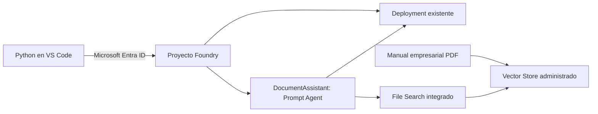

# Un agente documental con Microsoft Foundry y Python

[English](README.md) | **Español**

Demo introductoria: modelo -> PDF -> agente -> conversación. Todo se ejecuta desde
Python en VS Code; no hay interfaz web, MCP, contenedores ni infraestructura auxiliar.
Guion paso a paso para presentarla: [GUIA.md](GUIA.md) ([English](GUIDE.md)).

El PDF, los mensajes del terminal y las instrucciones del agente están en inglés.
El agente responde en el idioma de la pregunta, así que también puedes preguntar
en español. Los nombres de archivos y variables del código están en español
(`01_modelo.py`, `estado.json`, ...) y se mantienen así para que coincidan con
esta guía.

## Arquitectura



**Prompt Agent no significa sin código**: Python crea su definición (modelo,
instrucciones y herramientas); Foundry ejecuta la orquestación. No es un Hosted
Agent con runtime propio. El PDF no modifica ni reentrena el modelo: RAG recupera
fragmentos y los incorpora al contexto de la respuesta.

## Archivos

| Archivo | Para qué sirve |
| --- | --- |
| `01_modelo.py` | Pregunta directa al deployment con Responses API. |
| `02_documento.py` | Carga e indexación del PDF; reutilización del Vector Store. |
| `03_agente.py` | Creación o reutilización de una versión de DocumentAssistant. |
| `04_chat.py` | Chat por terminal con conversación y citas documentales. |
| `comun.py` | Configuración, persistencia de IDs y errores básicos. |
| `crear_pdf.py` | Generador reproducible del PDF de dos páginas. |
| `documentos/manual_empresa.pdf` | Manual ficticio listo para subir. |
| `.env.example` | Plantilla de configuración sin secretos; cópiala a `.env`. |
| `estado.json` | IDs remotos y huella del PDF; se crea al ejecutar las fases (no va a git). |
| `requirements.txt` | Versiones exactas de las cinco dependencias directas. |
| `test_demo.py` | Comprobaciones locales con dobles de prueba; no acceden a Azure. |
| `.vscode/launch.json` | F5 sobre el archivo Python abierto; terminal integrada. |

## Requisitos previos

1. Python 3.11 o superior (probado con Python 3.14).
2. VS Code con las extensiones Python y Python Debugger. GitHub Copilot es opcional
   para explicar y editar código, no es una dependencia en ejecución.
3. Proyecto del **nuevo Microsoft Foundry**, no un proyecto Hub/classic.
4. Deployment existente compatible con Responses y File Search en Prompt Agents.
   `gpt-5-mini` es el modelo del ejemplo oficial de File Search; usa el nombre real
   de tu deployment, que puede ser distinto. Su disponibilidad y cuota deben
   comprobarse en tu proyecto. No desplegamos un modelo nuevo.
5. Entorno de agentes **básico**, con almacenamiento y búsqueda administrados por
   Microsoft. No configurar Azure AI Search, Storage o embeddings manualmente.
6. Acceso de red al proyecto y sesión de Microsoft Entra ID con permisos adecuados.

### Permisos mínimos y autenticación

Asigna al presentador **Foundry User** en el ámbito del proyecto. En algunos
tenants todavía figura como **Azure AI User**. No necesita Owner o Contributor
de toda la suscripción para ejecutar esta demo. La asignación la realiza alguien
autorizado y puede tardar unos minutos en propagarse.

La guía de File Search también enumera **Storage Blob Data Contributor** sobre
la cuenta de almacenamiento del proyecto para las cargas a ese almacenamiento.
Si usas un proyecto Standard con Storage conectado, revisa ese permiso con su
administrador. Para esta demo se elige Basic: no crees una cuenta de Storage
adicional solo para asignar ese rol.

El código usa `DefaultAzureCredential`, sin API keys. Puedes utilizar una sesión
de Azure CLI (`az login`) en el tenant correcto; los scripts no ejecutan Azure
CLI ni inician sesión por sí solos. Revisa también variables `AZURE_*` antiguas:
pueden hacer que la cadena de credenciales elija otra identidad. Nunca añadas
claves, tokens o contraseñas a `.env`, al código o a Copilot.

## Preparación local

Clona el repositorio, abre una terminal PowerShell en su carpeta y crea el
entorno virtual:

```powershell
py -3 -m venv .venv
. .\.venv\Scripts\Activate.ps1
python -m pip install -r requirements.txt
Copy-Item .env.example .env
```

En macOS/Linux usa `python3 -m venv .venv`, `source .venv/bin/activate` y
`cp .env.example .env`. Si PowerShell bloquea la activación, revisa la política
de ejecución de tu equipo con su administrador.

Completa `.env` con tus valores:

```dotenv
FOUNDRY_PROJECT_ENDPOINT=https://YOUR_RESOURCE.services.ai.azure.com/api/projects/YOUR_PROJECT
FOUNDRY_MODEL_DEPLOYMENT_NAME=YOUR_DEPLOYMENT_NAME
AGENT_NAME=DocumentAssistant
```

Copia el endpoint **del proyecto**, no el de Azure OpenAI ni una URL del portal.
Es configuración, no un secreto. Las variables del entorno tienen prioridad sobre
`.env`; evita valores antiguos en tu terminal. Si compartes un proyecto de
Foundry con otras personas, usad un `AGENT_NAME` distinto cada uno.

No es necesario volver a generar el PDF incluido. Para inspeccionar su creación:

```powershell
python crear_pdf.py
```

## Ejecución por fases

Ejecuta una línea cada vez y explica el archivo correspondiente antes de seguir:

```powershell
python 01_modelo.py
python 02_documento.py
python 03_agente.py
python 04_chat.py
```

1. **Modelo**: imprime una explicación breve de un LLM. No usa el documento.
2. **Documento**: imprime IDs de archivo y Vector Store tras indexar. Guarda el
   estado inmediatamente después de crear el almacén y comprueba `completed`.
3. **Agente**: imprime nombre, versión y deployment. Conserva tus instrucciones
   y obliga a consultar File Search, la única herramienta configurada.
4. **Chat**: crea una conversación e invoca la versión guardada del agente.
   Escribe `exit` (o `salir`), Ctrl+C o fin de entrada para terminar.

Cada archivo tiene su propio punto de entrada: no importa ni ejecuta otra fase.
Las fases posteriores requieren los recursos de las anteriores, no su proceso
Python abierto. Todas las rutas se resuelven respecto a la carpeta del código.
Con el archivo abierto, F5 permite poner breakpoints y ejecutar en terminal.
No se utiliza Agent Inspector, porque no hay servidor HTTP local.

### Preguntas y resultados esperados

Puedes preguntar en español o en inglés; el agente responde en el idioma de la pregunta.

| Pregunta | Datos que debe recuperar del PDF |
| --- | --- |
| ¿Cuántos días de vacaciones tiene un empleado? | 24 días laborables al año. |
| ¿Cuál es la política de teletrabajo? | Dos días semanales con aprobación; miércoles presenciales. |
| ¿Cómo se solicitan los gastos de viaje? | Formulario GV-17, facturas y justificantes, máximo 10 días naturales desde el regreso. |
| ¿Qué formación ofrece la empresa? | IA, ciberseguridad y comunicación; 600 euros y 20 horas anuales. |
| ¿Cuál es el salario del director general? | La información no está disponible en el documento. |

Pregunta adicional: «¿Y con cuánta antelación se solicitan?» después de preguntar
por vacaciones. Debe responder 15 días naturales conservando el contexto.
Otros detalles verificables: hotel 120 euros/noche, comidas 28 euros/día,
kilometraje 0,26 euros/km y `people@lumina.example`, extensión 241.

Las referencias se obtienen de anotaciones `file_citation`: se muestra el nombre
cuando existe y el ID del archivo. No todas las respuestas tienen citas y la API
no garantiza el número de página; el programa no inventa referencias.

### Repetición sin duplicados

- Conserva `estado.json`: enlaza recursos con el endpoint y la huella del PDF.
- La fase 2 reutiliza el almacén y el archivo. Si se interrumpe la espera,
  vuelve a buscar el archivo dentro del almacén y espera su indexación.
- Para repetir la demostración de carga, puedes borrar el documento o el Vector
  Store desde Foundry y ejecutar otra vez `python 02_documento.py` sin borrar
  `estado.json`. Si falta el almacén (404), lo recrea; si está vacío, sube el PDF
  de nuevo. Los errores de permisos o conexión no provocan una recreación.
- Después de una recuperación, ejecuta `python 03_agente.py` y abre un chat nuevo
  con `python 04_chat.py`. La fase 2 invalida la versión local del agente para
  impedir que el chat utilice una referencia a un almacén eliminado. No borra
  versiones antiguas ni archivos remotos que hayan quedado fuera del almacén.
- Un PDF diferente provoca un error explícito, no otra carga silenciosa.
- La fase 3 busca versiones con la misma huella de configuración en los metadatos
  remotos. Solo crea versión si cambian modelo, instrucciones, herramienta o almacén.
- La fase 4 utiliza nombre **y versión**, no la última versión por accidente.
- Cambiar de endpoint con el mismo estado provoca un error para evitar mezclar proyectos.
- No ejecutes dos copias de las fases de creación simultáneamente. El estado local
  no es un mecanismo de exclusión para varios procesos o presentadores.
- No borres el estado para resolver un error. Si se pierde, recupera los IDs de
  Foundry antes de repetir la carga. Una interrupción justo entre creación remota
  y guardado local puede dejar un recurso huérfano; revisa el proyecto en ese caso.

## Guion didáctico: unos 20 minutos

| Tiempo | Mostrar y ejecutar | Mensaje clave |
| --- | --- | --- |
| 0–2 min | Arquitectura y `.env`, sin mostrar credenciales. | «Usamos un proyecto y un modelo ya desplegados». |
| 2–5 min | `01_modelo.py`: credencial, cliente y Responses. | «El LLM genera lenguaje; el deployment es su instancia accesible y el endpoint su dirección». |
| 5–9 min | Abrir PDF y ejecutar `02_documento.py`. | «RAG busca fragmentos antes de responder; embeddings representan similitud semántica. File Search fragmenta, indexa y combina búsqueda semántica y por palabras». |
| 9–13 min | `03_agente.py`: instrucciones y `FileSearchTool`. | «Un agente combina modelo, instrucciones y herramientas. Lo definimos con Python; Foundry gestiona las llamadas». |
| 13–18 min | `04_chat.py`: cuatro preguntas y una de seguimiento. | «La conversación conserva el contexto y las citas permiten contrastar la respuesta con el archivo». |
| 18–20 min | Pregunta por el salario; repetir fases 2 y 3. | «Sin evidencia debe reconocer que no sabe; reutilizamos recursos en lugar de crearlos otra vez». |

El documento privado no tiene que formar parte del entrenamiento: File Search
recupera contenido autorizado del almacén y lo aporta al modelo en cada consulta.
Esto no implementa aislamiento por empleado ni permisos por documento; no uses
datos reales para una demo pública. Las instrucciones y la búsqueda reducen las
alucinaciones, pero no garantizan su ausencia ni sustituyen controles de seguridad.

## Costes y conservación de recursos

La tarifa pública consultada el 26 de octubre de 2026 enumera File Search a
**2,50 USD/1.000 llamadas de herramienta** y almacenamiento vectorial a
**0,11 USD/GB/día**, con **1 GB gratuito**, sujeto a condiciones vigentes.
Los tokens del modelo (también el contexto recuperado) se facturan aparte.
Cinco llamadas de herramienta serían 0,0125 USD antes de tokens; una pregunta
puede generar más de una llamada. Es una referencia, no una cotización.

Usamos un único PDF pequeño, un único almacén y un deployment económico existente.
No desplegamos embeddings propios ni fijamos una caducidad automática. Verifica
la tarifa de tu región, moneda y contrato antes del evento. El almacenamiento
puede seguir generando coste aunque cierres Python.

**No hay limpieza automática.** Al terminar definitivamente, revisa en Foundry
los IDs de `estado.json` y elimina manualmente las versiones del agente creadas
por la demo, el Vector Store y el archivo subido. Si creaste varias versiones,
revisa todas, no solo la última registrada. No elimines el proyecto, el deployment
ni recursos compartidos. Eliminar un almacén no equivale a eliminar el archivo
subido; ambos deben revisarse. Las conversaciones también quedan en el servicio:
el ID de cada sesión se imprime al iniciar el chat. La retención depende del servicio.

## Checklist de pruebas

Pruebas locales, sin autenticación ni consumo de Azure:

```powershell
python -m unittest -v test_demo
python -m pip check
```

- [ ] Verificar que el PDF se abre, tiene dos páginas y texto seleccionable.
- [ ] Completar `.env`, autenticar la identidad y comprobar deployment y roles.
- [ ] Fase 1 devuelve texto mediante Responses.
- [ ] Fase 2 termina en `completed` e imprime los IDs persistidos.
- [ ] Repetir fase 2: mismos IDs, sin otra carga.
- [ ] Fase 3 crea DocumentAssistant; repetirla conserva la misma versión.
- [ ] Fase 4 responde correctamente a las cinco preguntas de la tabla.
- [ ] Comprobar al menos una cita real a `manual_empresa.pdf`.
- [ ] Comprobar pregunta de seguimiento y salida con `exit`.
- [ ] Comprobar que no inventa un salario ausente del PDF.
- [ ] Comparar recursos en Foundry antes y después de repetir fases 2 y 3.
- [ ] Revisar el coste y decidir cuándo eliminar manualmente los recursos.

Los tests locales usan dobles de prueba: validan el flujo del código, no la
disponibilidad del servicio, los permisos efectivos ni la calidad del modelo.
La comprobación real de extremo a extremo requiere tu configuración y sesión.

## Errores frecuentes

| Síntoma | Comprobar |
| --- | --- |
| Configuración incompleta | Endpoint y deployment de `.env`; variables antiguas del terminal. |
| Credencial no disponible / 401 | Sesión Entra ID local, tenant y cadena de DefaultAzureCredential. |
| 403 | Foundry User en el proyecto y propagación; almacenamiento si procede. |
| 404 | Endpoint del proyecto, nombre real del deployment e IDs remotos guardados. |
| 429 | Cuota y límites; esperar y reducir frecuencia de consultas. |
| Indexación fallida | PDF válido con texto; revisar `last_error` y permisos. |
| Sin respuesta o sin citas | Comprobar indexación, herramienta y compatibilidad del deployment. |

## Documentación oficial

- [File Search: ejemplo Python de Prompt Agents y diferencias Basic/Standard](https://learn.microsoft.com/en-us/azure/foundry/agents/how-to/tools/file-search).
- [SDK Azure AI Projects 2.x: autenticación y Responses mediante get_openai_client](https://learn.microsoft.com/en-us/python/api/overview/azure/ai-projects-readme?view=azure-python).
- [Ejemplo oficial de File Search en el SDK](https://github.com/Azure/azure-sdk-for-python/blob/main/sdk/ai/azure-ai-projects/samples/agents/tools/sample_agent_file_search_in_stream.py).
- [Precios oficiales de Azure OpenAI, incluidas herramientas integradas](https://azure.microsoft.com/en-us/pricing/details/cognitive-services/openai-service/).

La demo utiliza `azure.ai.projects` 2.x, `PromptAgentDefinition` y Responses.
No utiliza `azure-ai-agents` 1.x, Assistants API, threads/runs clásicos, toolboxes
MCP ni Microsoft Agent Framework.
