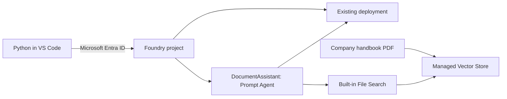

# A document agent with Microsoft Foundry and Python

**English** | [Español](README.es.md)

Introductory demo: model -> PDF -> agent -> conversation. Everything runs from
Python in VS Code; there is no web UI, MCP, containers or extra infrastructure.
Step-by-step presentation script: [GUIDE.md](GUIDE.md) ([español](GUIA.md)).

The PDF, terminal messages and agent instructions are in English. The agent
answers in the same language as the question, so you can also ask in Spanish.
File and variable names in the code are in Spanish (`01_modelo.py`,
`estado.json`, ...); they are kept as-is so the code matches this guide.

## Architecture



**A Prompt Agent is not "no code"**: Python creates its definition (model,
instructions and tools); Foundry runs the orchestration. It is not a Hosted
Agent with its own runtime. The PDF does not modify or retrain the model: RAG
retrieves fragments and adds them to the context of the answer.

## Files

| File | Purpose |
| --- | --- |
| `01_modelo.py` | Direct question to the deployment with the Responses API. |
| `02_documento.py` | Uploads and indexes the PDF; reuses the Vector Store. |
| `03_agente.py` | Creates or reuses a version of DocumentAssistant. |
| `04_chat.py` | Terminal chat with conversation context and document citations. |
| `comun.py` | Configuration, ID persistence and basic error handling. |
| `crear_pdf.py` | Reproducible generator of the two-page PDF. |
| `documentos/manual_empresa.pdf` | Fictitious handbook, ready to upload. |
| `.env.example` | Configuration template without secrets; copy it to `.env`. |
| `estado.json` | Remote IDs and PDF hash; created when you run the phases (not in git). |
| `requirements.txt` | Exact versions of the five direct dependencies. |
| `test_demo.py` | Local checks with test doubles; they do not call Azure. |
| `.vscode/launch.json` | F5 on the open Python file; integrated terminal. |

## Prerequisites

1. Python 3.11 or later (tested with Python 3.14).
2. VS Code with the Python and Python Debugger extensions. GitHub Copilot is
   optional for explaining and editing code; it is not a runtime dependency.
3. A project in the **new Microsoft Foundry**, not a Hub/classic project.
4. An existing deployment that supports Responses and File Search in Prompt
   Agents. `gpt-5-mini` is the model used in the official File Search sample; use
   the real name of your deployment, which may differ. Check availability and
   quota in your project. This demo does not deploy a new model.
5. A **basic** agent setup, with storage and search managed by Microsoft. Do not
   configure Azure AI Search, Storage or embeddings manually.
6. Network access to the project and a Microsoft Entra ID session with the
   right permissions.

### Minimum permissions and authentication

Assign the presenter **Foundry User** at project scope. In some tenants it is
still listed as **Azure AI User**. Owner or Contributor on the whole
subscription is not needed for this demo. The assignment must be done by
someone authorized and may take a few minutes to propagate.

The File Search guide also lists **Storage Blob Data Contributor** on the
project storage account for uploads to that storage. If you use a Standard
project with connected Storage, check that role with your administrator. This
demo uses Basic: do not create an extra Storage account just to assign it.

The code uses `DefaultAzureCredential`, without API keys. You can use an Azure
CLI session (`az login`) in the right tenant; the scripts do not run Azure CLI
or sign in by themselves. Also check for old `AZURE_*` environment variables:
they can make the credential chain pick a different identity. Never add keys,
tokens or passwords to `.env`, to the code or to Copilot.

## Local setup

Clone the repository, open a PowerShell terminal in its folder and create the
virtual environment:

```powershell
py -3 -m venv .venv
. .\.venv\Scripts\Activate.ps1
python -m pip install -r requirements.txt
Copy-Item .env.example .env
```

On macOS/Linux use `python3 -m venv .venv`, `source .venv/bin/activate` and
`cp .env.example .env`. If PowerShell blocks activation, check your machine's
execution policy with your administrator.

Fill in `.env` with your values:

```dotenv
FOUNDRY_PROJECT_ENDPOINT=https://YOUR_RESOURCE.services.ai.azure.com/api/projects/YOUR_PROJECT
FOUNDRY_MODEL_DEPLOYMENT_NAME=YOUR_DEPLOYMENT_NAME
AGENT_NAME=DocumentAssistant
```

Copy the **project** endpoint, not the Azure OpenAI endpoint or a portal URL.
It is configuration, not a secret. Environment variables take precedence over
`.env`; avoid stale values in your terminal. If you share a Foundry project
with other people, use a different `AGENT_NAME` each.

You do not need to regenerate the included PDF. To see how it is built:

```powershell
python crear_pdf.py
```

## Running the phases

Run one line at a time and explain the corresponding file before moving on:

```powershell
python 01_modelo.py
python 02_documento.py
python 03_agente.py
python 04_chat.py
```

1. **Model**: prints a short explanation of an LLM. It does not use the document.
2. **Document**: prints the file and Vector Store IDs after indexing. It saves
   the state right after creating the store and checks for `completed`.
3. **Agent**: prints name, version and deployment. It keeps your instructions
   and forces File Search, the only configured tool.
4. **Chat**: creates a conversation and calls the saved agent version.
   Type `exit`, press Ctrl+C or send end-of-input to finish.

Each file has its own entry point: it does not import or run another phase.
Later phases need the resources from earlier ones, not their Python process.
All paths are resolved relative to the code folder. With a file open, F5 lets
you set breakpoints and run it in the terminal. Agent Inspector is not used
because there is no local HTTP server.

### Questions and expected results

| Question | Data it should retrieve from the PDF |
| --- | --- |
| How many vacation days does an employee get? | 24 working days per year. |
| What is the remote work policy? | Two days per week with approval; Wednesdays on site. |
| How do I claim travel expenses? | Form GV-17, invoices and receipts, within 10 calendar days of returning. |
| What training does the company offer? | AI, cybersecurity and communication; 600 euros and 20 hours per year. |
| What is the CEO's salary? | The information is not available in the document. |

Follow-up question: "And how far in advance must it be requested?" after asking
about vacation. It should answer 15 calendar days, keeping the context.
Other verifiable details: hotel 120 euros/night, meals 28 euros/day, mileage
0.26 euros/km and `people@lumina.example`, extension 241.

References come from `file_citation` annotations: the file name is shown when
available, plus the file ID. Not every answer has citations and the API does
not guarantee a page number; the program does not invent references.

### Re-running without duplicates

- Keep `estado.json`: it links resources to the endpoint and the PDF hash.
- Phase 2 reuses the store and the file. If the wait is interrupted, it looks
  for the file in the store again and waits for indexing.
- To repeat the upload demo, delete the document or the Vector Store in Foundry
  and run `python 02_documento.py` again without deleting `estado.json`. If the
  store is missing (404) it is recreated; if it is empty, the PDF is uploaded
  again. Permission or connection errors do not trigger a re-creation.
- After a recovery, run `python 03_agente.py` and open a new chat with
  `python 04_chat.py`. Phase 2 invalidates the local agent version so the chat
  cannot use a reference to a deleted store. It does not delete old versions or
  remote files left outside the store.
- A different PDF raises an explicit error instead of a silent new upload.
- Phase 3 looks for versions with the same configuration hash in the remote
  metadata. It only creates a version if the model, instructions, tool or store
  change.
- Phase 4 uses the agent name **and version**, never the latest version by accident.
- Switching endpoint with the same state raises an error to avoid mixing projects.
- Do not run two copies of the creation phases at the same time. The local
  state is not a locking mechanism for several processes or presenters.
- Do not delete the state to fix an error. If it is lost, recover the IDs from
  Foundry before repeating the upload. An interruption right between remote
  creation and local save can leave an orphan resource; check the project then.

## Teaching script: about 20 minutes

| Time | Show and run | Key message |
| --- | --- | --- |
| 0–2 min | Architecture and `.env`, without showing credentials. | "We use a project and a model that are already deployed." |
| 2–5 min | `01_modelo.py`: credential, client and Responses. | "The LLM generates language; the deployment is its accessible instance and the endpoint its address." |
| 5–9 min | Open the PDF and run `02_documento.py`. | "RAG searches fragments before answering; embeddings represent semantic similarity. File Search chunks, indexes and combines semantic and keyword search." |
| 9–13 min | `03_agente.py`: instructions and `FileSearchTool`. | "An agent combines a model, instructions and tools. We define it in Python; Foundry handles the calls." |
| 13–18 min | `04_chat.py`: four questions and a follow-up. | "The conversation keeps the context and citations let you check the answer against the file." |
| 18–20 min | Ask about the salary; repeat phases 2 and 3. | "Without evidence it must admit it does not know; we reuse resources instead of creating them again." |

The private document does not have to be part of training: File Search
retrieves authorized content from the store and gives it to the model on every
query. This does not implement per-employee isolation or per-document
permissions; do not use real data in a public demo. Instructions and search
reduce hallucinations, but do not guarantee their absence or replace security
controls.

## Costs and resource lifetime

The public price list checked on 26 October 2026 lists File Search at
**USD 2.50 per 1,000 tool calls** and vector storage at **USD 0.11/GB/day**,
with **1 GB free**, subject to current terms. Model tokens (including retrieved
context) are billed separately. Five tool calls would be USD 0.0125 before
tokens; one question can generate more than one call. This is a reference, not
a quote.

We use a single small PDF, a single store and an existing, low-cost deployment.
We do not deploy our own embeddings or set an automatic expiry. Check pricing
for your region, currency and agreement before the event. Storage can keep
generating cost after you close Python.

**There is no automatic cleanup.** When you are done for good, review the IDs
in `estado.json` in Foundry and manually delete the agent versions created by
the demo, the Vector Store and the uploaded file. If you created several
versions, check all of them, not only the last one recorded. Do not delete the
project, the deployment or shared resources. Deleting a store does not delete
the uploaded file; check both. Conversations also stay in the service: the ID of
each session is printed when the chat starts. Retention depends on the service.

## Test checklist

Local tests, without authentication or Azure consumption:

```powershell
python -m unittest -v test_demo
python -m pip check
```

- [ ] Check that the PDF opens, has two pages and selectable text.
- [ ] Fill in `.env`, authenticate and check deployment and roles.
- [ ] Phase 1 returns text through Responses.
- [ ] Phase 2 ends in `completed` and prints the saved IDs.
- [ ] Repeat phase 2: same IDs, no new upload.
- [ ] Phase 3 creates DocumentAssistant; repeating it keeps the same version.
- [ ] Phase 4 answers the five questions in the table correctly.
- [ ] Check at least one real citation to `manual_empresa.pdf`.
- [ ] Check the follow-up question and exiting with `exit`.
- [ ] Check that it does not invent a salary that is not in the PDF.
- [ ] Compare resources in Foundry before and after repeating phases 2 and 3.
- [ ] Review the cost and decide when to delete the resources manually.

The local tests use test doubles: they validate the code flow, not service
availability, effective permissions or model quality. A real end-to-end check
needs your configuration and session.

## Common errors

| Symptom | Check |
| --- | --- |
| Incomplete configuration | Endpoint and deployment in `.env`; stale terminal variables. |
| Credential unavailable / 401 | Local Entra ID session, tenant and DefaultAzureCredential chain. |
| 403 | Foundry User on the project and propagation; storage if applicable. |
| 404 | Project endpoint, real deployment name and saved remote IDs. |
| 429 | Quota and limits; wait and reduce query frequency. |
| Indexing failed | Valid PDF with text; check `last_error` and permissions. |
| No answer or no citations | Check indexing, the tool and deployment compatibility. |

## Official documentation

- [File Search: Python sample for Prompt Agents and Basic/Standard differences](https://learn.microsoft.com/en-us/azure/foundry/agents/how-to/tools/file-search).
- [Azure AI Projects SDK 2.x: authentication and Responses via get_openai_client](https://learn.microsoft.com/en-us/python/api/overview/azure/ai-projects-readme?view=azure-python).
- [Official File Search sample in the SDK](https://github.com/Azure/azure-sdk-for-python/blob/main/sdk/ai/azure-ai-projects/samples/agents/tools/sample_agent_file_search_in_stream.py).
- [Official Azure OpenAI pricing, including built-in tools](https://azure.microsoft.com/en-us/pricing/details/cognitive-services/openai-service/).

The demo uses `azure.ai.projects` 2.x, `PromptAgentDefinition` and Responses.
It does not use `azure-ai-agents` 1.x, the Assistants API, classic threads/runs,
MCP toolboxes or Microsoft Agent Framework.
